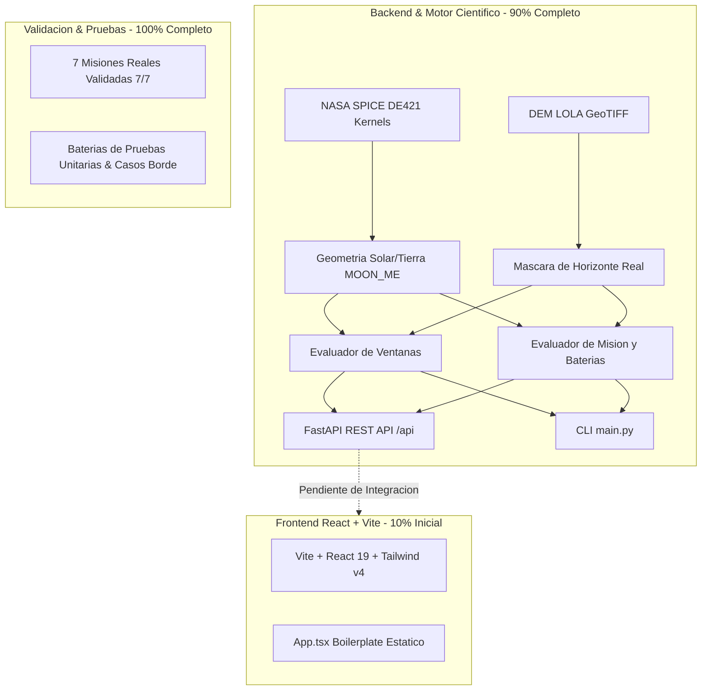
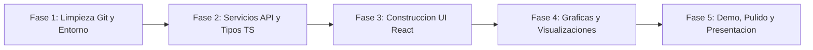

# 🚀 Planeación y Estado del Proyecto: Lunar Landing Site Navigator
**Equipo / Proyecto:** Bosón de Quásar · Lunar Landing  
**Fecha de corte:** Noviembre 2026  
**Rama principal de trabajo:** `DianaDev`

---

## 1. Visión y Objetivo del Proyecto

El **Lunar Landing Site Navigator** es una plataforma integral (Motor Científico en Python + API REST con FastAPI + Frontend interactivo en React/Tailwind) diseñada para planificar, evaluar y validar sitios y ventanas de aterrizaje en la superficie lunar (con especial foco en el Polo Sur y misiones de exploración CLPS / Artemis, así como misiones históricas).

El sistema responde con rigor matemático y orbital a dos preguntas críticas de ingeniería espacial:
1. **¿Dónde y cuándo es viable aterrizar?** (Modo Exploración / Rango de fechas): Evalúa si un punto $(x, y)$ en un período dado cuenta con condiciones seguras de iluminación solar continua y línea de visión directa con la Tierra para telemetría.
2. **¿Es viable mi misión planificada?** (Modo Misión / Fecha fija + Duración): Analiza un aterrizaje en una fecha específica para una duración determinada en días, verificando si las condiciones al descenso son óptimas, si la noche más larga supera la capacidad de baterías (`battery_hours`), o si los cortes de comunicación exceden la tolerancia (`max_comm_gap_hours`), sugiriendo ventanas alternativas si la misión no es viable.

Adicionalmente, el proyecto incorpora **relieve orográfico real** a partir de Modelos Digitales de Elevación (DEM) de la misión **LOLA (LRO)** de la NASA, calculando interferencias de montañas y cráteres que bloquean el Sol o la Tierra aún cuando astronómicamente estarían sobre el horizonte esférico ideal.

---

## 2. Diagnóstico del Estado Actual (¿Dónde estamos?)

El proyecto se encuentra en un estado con un **Backend de cálculo y API prácticamente completados y validados**, un **Frontend inicial en esqueleto**, y una **necesidad de ordenamiento y limpieza en la estructura del repositorio git**.



### 2.1 Backend y Núcleo de Cálculos (`lunar/`, `main.py`) — **~90% Completado**
- **Astronomía y Efemérides con NASA SPICE (`lunar/kernels.py`, `geometry.py`, `analysis.py`)**:
  - Kernels DE421 integrados (`de421.bsp`, `moon_pa_de421_1900-2050.bpc`, `moon_080317.tf`, `naif0012.tls`, `pck00008.tpc`).
  - Marco selenocéntrico `MOON_ME` con corrección de aberración y tiempo luz `LT+S`.
  - Precisión de eventos astronómicos (amaneceres, ocasos, earthrise, earthset) mediante bisección temporal a resolución de ~1 segundo.
  - Fracción iluminada del disco solar y diámetros angulares reales.
- **Relieve y Terreno con DEM de LOLA (`lunar/horizon.py`)**:
  - Integración de GeoTIFFs de altimetría LOLA (`LDEM_80S_80MPP_ADJ.TIF` a 80 m/píxel para el Polo Sur).
  - Precomputación de perfiles de horizonte 360° en `data/horizons.json` con paso de 0.25° de azimut para respuesta ultrarrápida.
  - Capacidad de cálculo dinámico al vuelo de horizontes para cualquier coordenada lunar.
- **Lógica de Viabilidad y Misiones (`lunar/evaluate.py`, `lunar/mission.py`)**:
  - Clasificación técnica: **CANDIDATO** / **NO CANDIDATO** con código de semáforo (`go`, `caution`, `nogo`).
  - Umbral $\epsilon$ de seguridad (por defecto 0.5°) para asegurar disco solar completo sobre el relieve y margen de señal.
  - Cálculo de ventanas óptimas de aterrizaje y sugerencia de fechas alternativas (`before` y `after`).
- **Validación con Misiones Reales (`lunar/validation.py`, `output/validation_report.md`)**:
  - **7/7 misiones reales pasan la validación:** Apollo 11, IM-1 Odysseus (Malapert A), SLIM (cráter Shioli), Blue Ghost M1 (Mare Crisium), IM-2 Athena (Mons Mouton), Chandrayaan-3 Vikram (Statio Shiv Shakti) y Chang'e-6 (polo sur / lado oculto).
- **Catálogo de Sitios (`data/sites.json`)**:
  - 15 sitios con coordenadas verificadas y fuentes bibliográficas (Artemis, CLPS, Apollo).
- **CLI (`main.py`)**:
  - Comandos completos: `sites`, `sky`, `report`, `evaluate`, `mission`, `validate`, `events`, `series`, `compare`, `sweep`, `horizon`, `export`, `download`.

### 2.2 API REST (`api.py`) — **~95% Completado**
- Framework: **FastAPI** + **Uvicorn** + **Pydantic v2**.
- Documentación interactiva Swagger UI en `/docs`.
- Configurado CORS para permitir consumo desde `http://localhost:5173` (Vite).
- Endpoints activos:
  - `POST /api/evaluate` y `GET /api/evaluate`: Rango de fechas, métricas agregadas y ventanas candidatas.
  - `POST /api/mission` y `GET /api/mission`: Evaluación de aterrizaje en fecha fija + duración + batería + hueco de comunicación + fechas alternativas.
  - `GET /api/sites`: Listado de sitios de interés y sus coordenadas.
  - `GET /api/health`: Chequeo de salud del servicio y metadatos de kernels SPICE.

### 2.3 Frontend (`frontend/`) — **~10% Inicial**
- Stack instalado: React 19, TypeScript, Vite, Tailwind CSS v4 (`@tailwindcss/vite`).
- Situación actual: Es la plantilla base de Vite con el título `"Bosón de Quásar - Lunar Landing"` en `src/App.tsx`.
- **Estado:** Pendiente de conectar con la API y construir la interfaz gráfica de usuario.

### 2.4 Control de Versiones y Repositorio — **Requiere Limpieza**
- En el historial de Git (commit `2e77cbc`), los archivos de backend se subieron accidentalmente dentro de una subcarpeta `DIANA/`.
- Posteriormente, los archivos se copiaron correctamente a la raíz del repositorio (`C:\Users\diana\Lunar_Landing\`), quedando como archivos no rastreados (*untracked*) en la raíz.
- Actualmente no existe un `.gitignore` en la raíz, lo que hace que archivos binarios gigantescos (como el DEM de 189 MB `LDEM_80S_80MPP_ADJ.TIF` y kernels `.bsp`) y directorios de entorno (`.venv`, `output/`, `__pycache__`) aparezcan pendientes de commit.

---

## 3. Matriz de Estado de Componentes

| Componente | Módulo / Archivo | Estado | Qué hace / Qué falta |
| :--- | :--- | :---: | :--- |
| **Cálculos SPICE** | `lunar/kernels.py`, `geometry.py`, `analysis.py` | 🟢 Listo | Posiciones precisas de Sol y Tierra, eventos astronómicos, disco solar y **vectores 3D (orbitales y topocéntricos)**. |
| **Horizontes y DEM** | `lunar/horizon.py`, `data/horizons.json` | 🟢 Listo | Relieve real con DEM LOLA y precomputación de perfiles 360°. |
| **Evaluación de Ventanas** | `lunar/evaluate.py` | 🟢 Listo | Barrido temporal, porcentajes de luz/comunicación y cálculo de ventanas. |
| **Evaluación de Misión** | `lunar/mission.py` | 🟢 Listo | Reglas de descenso, batería, corte de enlace y alternativas cercanas. |
| **Validación Histórica** | `lunar/validation.py`, `data/real_missions.json` | 🟢 Listo | 7 de 7 misiones lunares reales validadas con éxito. |
| **Suite de Pruebas** | `tests/test_*.py` | 🟢 Listo | 42 pruebas unitarias y de integración preparadas. |
| **API REST** | `api.py` | 🟢 Listo | Endpoints listos, documentados con Swagger y con CORS habilitado. |
| **CLI de Terminal** | `main.py` | 🟢 Listo | Interfaz por consola con comandos para reportes y barridos. |
| **Estructura Git & Limpieza** | Raíz y subdirectorio `DIANA/` | 🟡 Requiere Orden | Falta eliminar `DIANA/`, agregar `.gitignore` y commitear archivos de raíz. |
| **Conector API Frontend** | `frontend/src/services/api.ts` | 🔴 Pendiente | Cliente fetch/axios y tipos TypeScript para interactuar con la API. |
| **Formulario de Entrada UI** | `frontend/src/components/MissionForm.tsx` | 🔴 Pendiente | Inputs de sitio/coordenadas, fechas, duración, $\epsilon$ y batería. |
| **Panel de Veredicto UI** | `frontend/src/components/CandidateCard.tsx` | 🔴 Pendiente | Semáforo visual, checks cumplidos/fallidos y fechas alternativas. |
| **Gráficas y Línea de Tiempo** | `frontend/src/components/Charts.tsx` | 🔴 Pendiente | Gráfica de elevación vs tiempo y perfil de horizonte del terreno. |
| **Catálogo Interactivo** | `frontend/src/components/SiteSelector.tsx` | 🔴 Pendiente | Selección amigable de sitios Artemis/CLPS/Apollo con 1 clic. |

---

## 4. Plan de Acción y Continuación (Roadmap Paso a Paso)

Para continuar el proyecto sin perder el hilo y completar una entrega de alto nivel, seguiremos este orden estructurado:



### 📍 Fase 1: Limpieza del Repositorio y Entorno (Prioridad Inmediata)
1. **Crear `.gitignore` en la raíz:**
   - Ignorar: `.venv/`, `__pycache__/`, `.pytest_cache/`, `output/`, `data/dem/*.TIF`, `data/dem/*.tif`, y `.idea/`.
   - *Nota de seguridad:* El archivo `LDEM_80S_80MPP_ADJ.TIF` pesa 189 MB. No debe subirse a Git ordinario (GitHub rechaza archivos >100 MB sin Git LFS).
2. **Consolidar el repositorio:**
   - Eliminar la carpeta redundante `DIANA/` del control de versiones.
   - Añadir y commitear en `DianaDev` los archivos de la raíz: `api.py`, `main.py`, `requirements.txt`, `README_BACKEND.md`, `lunar/`, `kernels/`, `data/sites.json`, `data/real_missions.json`, `data/horizons.json`, `tests/` y `planeacion.md`.

---

### 📍 Fase 2: Capa de Integración Frontend - Backend (Próximo paso de desarrollo)
1. **Definir Tipos TypeScript (`frontend/src/types/lunar.ts`):**
   - Mapear las respuestas JSON de FastAPI: `Site`, `EvaluateRequest`, `EvaluateResponse`, `MissionRequest`, `MissionResponse`, `SkyStatus`, `CheckResult`, `AlternativeDate`.
2. **Crear Cliente API (`frontend/src/services/api.ts`):**
   - Funciones asíncronas tipadas:
     - `fetchSites(): Promise<Site[]>`
     - `evaluateWindow(params: EvaluateRequest): Promise<EvaluateResponse>`
     - `evaluateMission(params: MissionRequest): Promise<MissionResponse>`
     - `checkHealth(): Promise<HealthResponse>`

---

### 📍 Fase 3: Construcción de la Interfaz de Usuario (UI)
Diseñar una interfaz oscura / espacial, limpia e intuitiva con Tailwind CSS:
1. **Barra Superior / Header:**
   - Logo y nombre: **Lunar Landing Site Navigator** (Bosón de Quásar).
   - Indicador de estado del Backend (Online/Offline mediante `/api/health`).
2. **Selector de Sitios y Coordenadas:**
   - Dropdown interactivo con los sitios del catálogo (`data/sites.json` agrupados por Polo Sur Artemis, CLPS, Apollo).
   - Modo "Coordenadas manuales" con campos de Longitud ($x$) y Latitud ($y$).
3. **Selector de Modo de Análisis:**
   - **Pestaña A: Planificar Misión (`/api/mission`) [Modo Principal]:**
     - Fecha y hora de aterrizaje (UTC).
     - Duración prevista en superficie (días).
     - Configuración avanzada colapsable: Batería (horas), tolerancia de corte de comunicación (horas), margen $\epsilon$ (grados), altura del sensor ($h_{obs}$).
   - **Pestaña B: Explorar Ventanas (`/api/evaluate`):**
     - Rango de fechas (inicio - fin) para encontrar las mejores fechas para aterrizar.
4. **Panel de Resultados y Veredicto:**
   - **Badge principal:** `CANDIDATO` (verde) o `NO CANDIDATO` (rojo/ámbar).
   - **Tarjetas de Comprobaciones (Checks):**
     - ☀️ Sol al aterrizar: Elevación actual vs terreno + $\epsilon$.
     - 🌍 Tierra al aterrizar: Visibilidad directa para descenso seguro.
     - 🔋 Noche lunar más larga vs capacidad de batería.
     - 📡 Hueco de comunicación más largo vs tolerancia de enlace.
   - **Alternativas Sugeridas:** Si una misión no cumple los requisitos, mostrar botones para aplicar automáticamente fechas viables más cercanas (`before` / `after`).

---

### 📍 Fase 4: Gráficas Temporales y Perfil de Horizonte
1. **Instalar librería de visualización en el frontend (ej. `recharts` o `lucide-react` para iconos):**
   ```bash
   cd frontend
   npm install recharts lucide-react
   ```
2. **Gráfica de Elevación vs Tiempo (`include_series: true`):**
   - Curva dorada/amarilla para el Sol, curva azul para la Tierra.
   - Línea de horizonte de terreno (gris/marrón) y zona de seguridad $\epsilon$.
   - Marcador visual vertical en el momento exacto del aterrizaje.
3. **Diagrama de Perfil de Horizonte (Horizonte 360°):**
   - Gráfica polar o cartesiana (Azimut 0° a 360° vs Elevación del relieve) mostrando las montañas alrededor del sitio y por dónde pasan el Sol y la Tierra.

---

### 📍 Fase 5: Validación, Pulido y Presentación Final
1. **Validación de Casos de Éxito en Vivo:**
   - Demostrar en la interfaz cómo el sistema evalúa con precisión misiones reales como Apollo 11 o IM-2 Athena.
2. **Scripts de Ejecución Sencillos:**
   - Proveer un comando o script para levantar backend y frontend simultáneamente en desarrollo.
3. **Documentación del Usuario:**
   - Actualizar el `README.md` principal con capturas, arquitectura y flujo de ejecución para evaluadores o usuarios finales.

---

## 5. Glosario Técnico y Criterios Científicos Clave

Para mantener la coherencia matemática y física durante todo el desarrollo:

- **Marco de Referencia Selenocéntrico (`MOON_ME`)**:
  - *Mean Earth/Polar Axis*: Marco lunar oficial donde el eje Z apunta al polo norte de rotación lunar y el eje X hacia la dirección media de la Tierra.
- **Corrección de Aberración y Tiempo Luz (`LT+S`)**:
  - Corrige el tiempo que tarda la luz en viajar de la Luna a la Tierra/Sol y el efecto estelar de aberración.
- **Umbral de Seguridad ($\epsilon = 0.5^\circ$)**:
  - El Sol tiene un radio angular de $\approx 0.27^\circ$. Un $\epsilon = 0.5^\circ$ garantiza que el disco solar entero esté visible por encima de las montañas, más un margen para paneles solares. Para la Tierra ($\approx 0.95^\circ$ de radio), asegura margen de lóbulo de radiación para la antena de alta ganancia.
- **Interferencia de Terreno (`terrain_interference`)**:
  - Ocurre cuando astronómicamente el astro está sobre la esfera lisa lunar ($> 0^\circ$), pero una elevación orográfica del terreno (capturada por el DEM de LOLA) se interpone en la línea de visión directa.
- **Regla de Candidatura de Misión**:
  $$\text{CANDIDATO} \iff (\text{Sol}_{\text{despejado}} \land \text{Tierra}_{\text{despejada}} \land \text{Noche}_{\max} \le \text{Batería} \land \text{Gap}_{\text{comm}} \le \text{Tolerancia})$$

---

## 6. Comandos Rápidos de Consulta para el Equipo

### Levantar el Backend (API)
```powershell
# En la raíz del proyecto (C:\Users\diana\Lunar_Landing)
uvicorn api:app --reload --port 8000
# Documentación interactiva: http://localhost:8000/docs
```

### Ejecutar Pruebas y Validación Científica
```powershell
# Validación contra las 7 misiones reales:
python main.py validate

# Ejecutar suite de pruebas pytest:
pytest tests -q
```

### Levantar el Frontend (Vite)
```powershell
cd frontend
npm run dev
# Interfaz de usuario: http://localhost:5173
```

---

*Documento generado y mantenido para el seguimiento continuo del desarrollo en el repositorio Lunar_Landing.*
